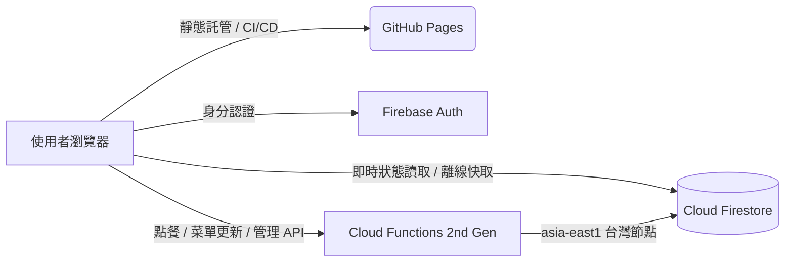

# 🍱 午餐 / 飲料智慧訂餐系統 (Lunch Order System)

[](https://github.com/hippoking1/Lunch-Order-System/actions/workflows/deploy.yml)
[](https://react.dev/)
[](https://www.typescriptlang.org/)
[](https://vitejs.dev/)
[](https://firebase.google.com/)

> 現代化、高效能、支援多規格自訂與對帳的企業級午餐與飲料訂餐系統。  
> 專為公司內部訂餐流程打造，全面由舊有 Google Apps Script (GAS) 升級遷移至 **GitHub Pages + Firebase (Firestore & Cloud Functions 2nd Gen)** 現代化無伺服器架構。

🌐 **線上使用網址 (Live Demo)**：[https://hippoking1.github.io/Lunch-Order-System/](https://hippoking1.github.io/Lunch-Order-System/)

---

## 🌟 核心特色與功能

### 1. 🚀 流暢前台點餐體驗
- **多維度分類與快速搜尋**：支援「正餐」、「飲料」、「甜點」快速切換，支援品項與風味即時模糊搜尋。
- **精準規格客製化**：
  - **飲品自訂規格**：依不同飲料店家動態讀取專屬的甜度與冰塊選項（支援特殊規格如「僅供正常與半糖」、「固定甜度」等）。
  - **份量與尺寸切換**：支援單品項多種份量定價（如大杯/中杯、大碗/小碗）。
  - **加點配料 (Extras)**：支援加料、升級套餐、辣度等單選互斥或多選加購，支援「N選M」免費配料智慧折抵。
- **員工帳戶餘額扣款與現金支付**：
  - 輸入員工姓名即時帶出帳戶餘額與近期 30 天常用點餐紀錄。
  - 自由選擇是否使用帳戶餘額扣款，餘額不足時自動轉為現金找零試算。
- **餐廳鎖定機制**：訂餐截止後可由負責人一鍵鎖定該餐廳，跨裝置即時生效，防止逾時點餐。

### 2. 📊 訂單總覽與即時對帳 (Summary & Recon)
- **即時統計卡片**：總訂單數、總金額、各餐廳份數與金額統計。
- **依餐廳分組彙整**：自動產出致電訂餐明細（品項統計、規格加料備註、外送電話一鍵撥打）。
- **依員工對帳核銷**：即時計算實收金額、找零進度與餘額支付明細。
- **歷史日期回溯**：日曆元件可自由選擇過往歷史日期，即時調閱歷史訂單紀錄。
- **安全退款機制**：刪除已付款訂單時，餘額扣款自動退回帳戶，現金付款提示實體找零退還。

### 3. ⚙️ 強大智慧後台管理 (Admin Panel)
- **Firebase Auth 安全認證**：支援 Google 帳號一鍵登入與管理者角色權限驗證。
- **🏪 專屬餐廳管理 (Restaurant Manager)**：
  - 餐廳新增、停用/啟用開關、電話與分類編輯。
  - **🥤 飲料店甜度/冰塊規格自訂**：可自由為特定飲料店新增/刪除專屬的冰塊與甜度清單，亦可一鍵還原預設。
- **📋 菜單品項管理 (Menu Items)**：
  - 菜單品項增刪修、期間限定/新品上市/店長推薦優先排序標記。
  - **➕ 加點項目區塊 (Extras Manager)**：獨立管理加點配料（自由增刪加料項目、設定加購金額、分組名稱與單選/複選）。
- **📝 智慧菜單文字 / CSV 匯入比對 (Diff Importer)**：
  - 支援傳統菜單文字及標準 CSV 格式一鍵貼上解析。
  - **名稱正規化與防重複**：全形/半形括號、符號、空格自動標準化比對，防止同名菜品重複建立。
  - **高對比 Diff 審核面板**：清楚標記「價格異動 (原價 ➔ 新價)」、「分類調整」，內容完全一致品項自動標記為 `unchanged` 折疊收合。
  - **🧹 一鍵重複品項清理**：一鍵掃描並清除資料庫同店多餘的重複文檔。

---

## 🛠️ 技術架構



| 領域 | 技術 / 工具 | 說明 |
| :--- | :--- | :--- |
| **前端框架** | React 19 + TypeScript | 最新 React 核心，全型別保障 |
| **建構工具** | Vite 6 | 極速開發與生產打包優化 |
| **狀態管理** | Zustand | 輕量高響應的全域狀態控制 |
| **UI 與樣式** | Vanilla CSS3 + Modern Glassmorphism | 高對比暗色科技主題，深度自適應 RWD |
| **圖標庫** | Lucide React | 清晰現代化的向量圖標集 |
| **後端計算** | Firebase Cloud Functions (Node 20) | 2nd Gen HTTPS Callable & REST API (台灣機房) |
| **資料庫** | Google Cloud Firestore | NoSQL 即時資料庫，複合索引與安全規則保護 |
| **CI/CD** | GitHub Actions | Push main 自動建置發布至 GitHub Pages |

---

## 📁 專案目錄結構

```text
訂餐系統_Git/
├── .github/
│   └── workflows/
│       └── deploy.yml            # GitHub Actions 自動部署流程
├── firebase/
│   ├── functions/                # Cloud Functions 後端原始碼
│   │   └── src/
│   │       ├── index.ts          # API 進入點與導出端點
│   │       ├── menu.ts           # 菜單管理、品項比對與去重
│   │       ├── orders.ts         # 點餐、刪單、歷史彙總與退款
│   │       ├── locks.ts          # 餐廳鎖定與電話查詢
│   │       └── shared/           # 共享型別與名稱正規化工具
│   ├── firestore.rules           # Firestore 安全規則
│   ├── firestore.indexes.json    # Firestore 複合索引
│   └── firebase.json             # Firebase 專案設定檔
├── frontend/
│   ├── src/
│   │   ├── components/
│   │   │   ├── admin/            # 後台管理 (餐廳、菜單、加點、CSV匯入)
│   │   │   ├── ordering/         # 前台點餐 (品項卡片、規格客製彈窗)
│   │   │   ├── summary/          # 訂單彙整與對帳卡片
│   │   │   └── common/           # 共用組件 (Modal, Toast, Layout)
│   │   ├── firebase.ts           # Firebase SDK 初始化 (環境變數注入)
│   │   ├── store.ts              # Zustand 核心狀態與離線 Fallback 邏輯
│   │   ├── types.ts              # 全域 TypeScript 介面型別定義
│   │   └── utils/                # CSV 比對與菜單解析工具
│   ├── package.json
│   └── vite.config.ts
├── scripts/
│   ├── export-sheets.gs          # 原 Google Sheets 一鍵匯出腳本
│   └── import-local.mjs          # 本地批次匯入 Firestore 工具
├── README.md                     # 專案主說明文件
└── README_DEPLOY.md              # 完整部署手冊與搬遷教學
```

---

## 🚀 本地開發指南

### 1. 複製專案
```bash
git clone https://github.com/hippoking1/Lunch-Order-System.git
cd Lunch-Order-System
```

### 2. 前端開發
```bash
cd frontend
npm install
npm run dev
```
瀏覽器開啟 `http://localhost:5173/` 即可即時預覽。

### 3. 後端 Cloud Functions 編譯
```bash
cd ../firebase/functions
npm install
npm run build
```

---

## 📦 部署與更新說明

詳細完整的從零部署教學、資料庫搬遷與 Firebase 設定請參閱：  
👉 [**完整部署教學手冊 (README_DEPLOY.md)**](./README_DEPLOY.md)

### 快速部署更新：
- **前端更新**：推送程式碼至 GitHub `main` 分支，GitHub Actions 會在 2 分鐘內自動完成建置並上線至 GitHub Pages。
- **後端 Functions 更新**：
  ```bash
  cd firebase
  firebase deploy --only functions
  ```

---

## 📄 License
本專案為內部訂餐管理系統，版權所有 © 2026。
