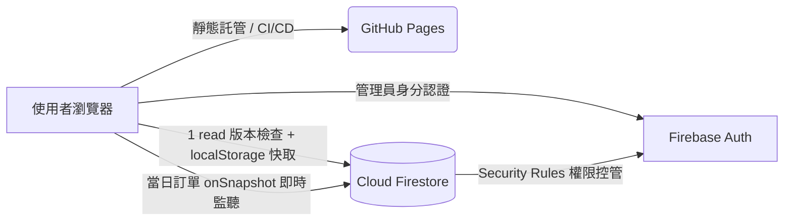

# 🍱 午餐 / 飲料智慧訂餐系統 (Lunch Order System)

[](https://github.com/hippoking1/Lunch-Order-System/actions/workflows/deploy.yml)
[](https://react.dev/)
[](https://www.typescriptlang.org/)
[](https://vitejs.dev/)
[](https://firebase.google.com/)

> 現代化、高效能、支援多規格自訂與對帳的企業級午餐與飲料訂餐系統。  
> 專為公司內部訂餐流程打造，採用 **GitHub Pages + Firebase Spark 免費方案 (Firestore 聚合快取 & 即時監聽 + Firebase Auth)** 零費用架構，無需 Cloud Functions 即可達成跨裝置即時同步。

🌐 **線上使用網址 (Live Demo)**：[https://hippoking1.github.io/Lunch-Order-System/](https://hippoking1.github.io/Lunch-Order-System/)

---

## 🌟 核心特色與功能

### 1. 🚀 流暢前台點餐體驗
- **多維度分類、子分類快速跳轉與即時搜尋**：支援「正餐」、「飲料」、「甜點」快速切換，超過 3 個子分類時自動顯示黏性橫向子分類快速跳轉列（Sticky Subcategory Chips），搭配 `content-visibility: auto` 渲染隔離確保百項長菜單流暢滑動。
- **記憶訂餐人、今日已點明細與同店連點**：自動記憶上次訂餐人、即時顯示該員工「今日已點明細條」防重複下單、雙向觸發近期 30 天常用點餐紀錄，送出訂單後保留當前餐廳方便同店連續加點；手機版底部導覽列即時顯示今日份數與未結清徽章。
- **精準規格客製化、甜度冰塊記憶與特價連動**：
  - **飲品單點膠囊與個人偏好記憶**：甜度與冰塊改為一指直點膠囊按鈕，並依員工自動記憶上次選擇（跨店家智慧比對店家專屬選項），搭配手機版原生 `<dialog>` 底部抽屜面板，點飲料無需來回捲動。
  - **份量、特價與加點折抵**：單一計價純函式 (`getEffectiveUnitPrice` / `calculateItemPricing`) 統一計算多份量定價、限時特價、`N選M` 免費配料折抵與結帳扣款。
- **彈性帳戶儲值與餘額扣款（後台可開關）**：支援於後台「品項管理」隨時切換啟用／關閉儲值與餘額扣款功能（預設關閉以貼合純現金對帳流程）；開啟後支援餘額扣款、行內儲值與餘額不足即時差額警示。
- **餐廳鎖定機制**：訂餐截止後可由負責人一鍵鎖定該餐廳，跨裝置即時生效，防止逾時點餐。

### 2. 📊 訂單總覽、發餐勾選與即時對帳 (Summary & Recon)
- **收據統計條與視圖切換**：頂部即時呈現總份數、今日總額、已結清比例進度條；手機版獨立分離「總覽（叫餐彙整）」與「帳務（員工對帳）」分頁，桌面版支援視圖切換與「僅看未結清」篩選。
- **依餐廳分組彙整、發餐領取勾選與一鍵複製**：自動依品項與規格排序產出致電訂餐明細，支援「一鍵複製叫餐明細」至剪貼簿與電話直撥連結 (`tel:`)；員工清單明細內建「發餐領取打勾」與領取進度追蹤（本地記憶零寫入耗損）。
- **依員工快速對帳核銷**：支援「剛好結清」一鍵結算、常用大鈔面額 (`$100`/`$500`/`$1000`) 快速算找零，以及 IME 中文輸入法防誤觸之備註即時修改與刪除退還餘額。
- **歷史日期回溯**：日曆元件可自由選擇過往歷史日期，即時調閱歷史訂單紀錄。

### 3. ⚙️ 強大智慧後台管理 (Admin Panel)
- **Firebase Auth 安全認證**：支援 Google 帳號登入（彈窗與重新導向備案）及 Email/密碼驗證。
- **🏪 專屬餐廳管理 (Restaurant Manager)**：
  - 支援「上架中 / 已下架 / 全部」快速切換與下架保護。
  - **飲料店甜度/冰塊規格自訂**：採用原生 `<dialog>` 支援亮／暗雙主題、拖曳排序與箭頭調整，可自訂專屬選項或一鍵還原預設。
- **📋 菜單品項、份量編輯與系統設定 (Menu & Combos)**：
  - 劃分「正式菜單品項」、「套餐選擇」、「加點 / 配料項目」三大分頁，支援多行批次輸入、文字貼上解析，並可直接在品項列表檢視與行內編輯獨立份量規格。
  - 內建「新品展示天數」與「啟用儲值與餘額扣款功能」全域即時開關。
- **📝 智慧菜單文字 / CSV 匯入比對與份量冪等同步 (Diff Importer)**：
  - 內建 Gem Prompt 複製、CSV 隨機餐廳 ID 自動綁定與分類繼承、高對比 Diff 審核面板。
  - 採用確定性文件 ID (`restaurantId_menuItemId_portionName`) 與單次批次同步，徹底杜絕更新菜單時產生重複份量或漏更新；「一鍵清理重複品項與份量」可同步掃描清除重複品項及孤兒／重複 `itemPortions` 文件。
- **🧹 歷史點餐紀錄區間清理 (Order Cleanup)**：
  - 支援快速區間（30 天前 / 90 天前 / 上個月）或自訂日期範圍，兩段式「先查詢預覽筆數 → 再確認永久刪除」過期 `orders`、`confirmations` 與 `categoryLocks`（不退還已扣款餘額），避免資料庫持續膨脹。

---

## 🛠️ 技術架構



| 領域 | 技術 / 工具 | 說明 |
| :--- | :--- | :--- |
| **前端框架** | React 19 + TypeScript | 最新 React 核心，全型別保障 |
| **建構工具** | Vite 8 | 極速開發與生產打包優化 |
| **狀態管理** | Zustand | 輕量高響應的全域狀態控制 |
| **UI 與樣式** | Vanilla CSS3 (Warm Neutral Receipt Design) | 暖色調收據風暗/亮雙主題，單一強調色與 `tabular-nums` 等寬數字對齊 |
| **圖標庫** | Lucide React | 統一 16px / 1.5px stroke 線條向量圖標，無裝飾性 Emoji |
| **資料層與交易** | Cloud Firestore SDK (`runTransaction` + `onSnapshot`) | 版本化菜單聚合快取 (`catalog/menuBundle`) + 當日訂單即時同步 |
| **認證與規則** | Firebase Auth + Firestore Security Rules | `adminEmails` 白名單控管後台寫入權限，維持 Spark 免費方案 ($0/月) |
| **CI/CD** | GitHub Actions | Push main 自動建置發布至 GitHub Pages |

---

## 📁 專案目錄結構

```text
訂餐系統_Git/
├── .github/
│   └── workflows/
│       └── deploy.yml            # GitHub Actions 自動部署流程
├── firebase/
│   ├── firestore.rules           # Firestore 安全規則
│   ├── firestore.indexes.json    # Firestore 複合索引
│   └── firebase.json             # Firebase 專案設定檔
├── frontend/
│   ├── src/
│   │   ├── components/
│   │   │   ├── admin/            # 後台管理 (餐廳、菜單、加點、CSV匯入、紀錄清理)
│   │   │   ├── ordering/         # 前台點餐 (品項卡片、規格客製彈窗)
│   │   │   ├── summary/          # 訂單彙整與對帳卡片 (onSnapshot 即時同步)
│   │   │   └── common/           # 共用組件 (Modal, Toast, Layout)
│   │   ├── services/
│   │   │   └── firestoreApi.ts   # Firestore 聚合快取、交易與即時監聽服務
│   │   ├── firebase.ts           # Firebase SDK 初始化 (Firestore + Auth)
│   │   ├── store.ts              # Zustand 核心狀態與樂觀更新
│   │   ├── types.ts              # 全域 TypeScript 介面型別定義
│   │   └── utils/                # CSV 比對、菜單解析與名稱正規化工具
│   ├── package.json
│   └── vite.config.ts
├── scripts/
│   ├── build-catalog-cache.mjs   # 建置 Firestore 聚合快取與 adminEmails 白名單
│   ├── export-sheets.gs          # 原 Google Sheets 一鍵匯出腳本
│   └── import-local.mjs          # 本地批次匯入 Firestore 工具
├── firestore.rules               # 根目錄 Firestore 安全規則 (同步維護)
├── firebase.json                 # 根目錄 Firebase 設定檔
├── README.md                     # 專案主說明文件
└── README_DEPLOY.md              # 完整部署手冊與搬遷教學
```

---

## 🚀 本地開發指南

### 1. 複製專案
```bash
git clone https://github.com/hippoking1/Lunch-Order-System.git
cd Lunch-Order-System
```

### 2. 前端開發
```bash
cd frontend
npm install
npm run dev
```
瀏覽器開啟 `http://localhost:5173/` 即可即時預覽。

---

## 📦 部署與更新說明

詳細完整的從零部署教學、資料庫搬遷與 Firebase 設定請參閱：  
👉 [**完整部署教學手冊 (README_DEPLOY.md)**](./README_DEPLOY.md)

### 快速部署更新：
- **前端更新**：推送程式碼至 GitHub `main` 分支，GitHub Actions 會在 2 分鐘內自動完成建置並上線至 GitHub Pages。
- **Firestore 安全規則與索引更新**：
  ```bash
  firebase deploy --only firestore:rules,firestore:indexes
  ```
- **重建菜單聚合快取（若手動修改資料庫後需要）**：
  ```bash
  node scripts/build-catalog-cache.mjs
  ```

---

## 📄 License
本專案為內部訂餐管理系統，版權所有 © 2026。
